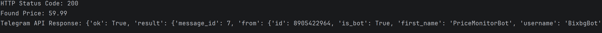
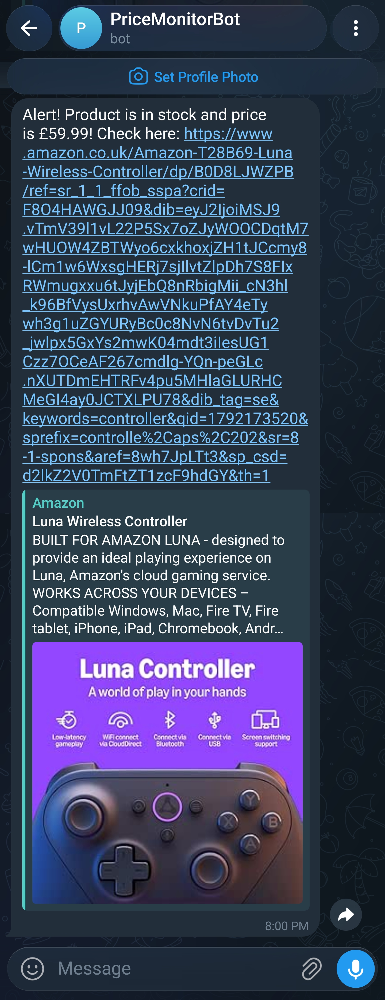

# Telegram Price & Stock Monitor

A background Python application that monitors web pages for prices, restocks, and matching listings, sending automated instant Telegram notifications directly to your phone

## Overview

This project automates tracking product availability and price drops.

Built with Python, the application fetches target URLs using custom headers to bypass blocks, parses product data and stock status using BeautifulSoup, evaluates conditions against user-defined thresholds, and triggers real-time alerts via the Telegram Bot API

## Features

* Continuously checks products price and stock in 5 minute interval
* Checks product price against target price
* Checks product availability
* Sends mobile notifications
* Provides simple console feedback on errors encountered

## Application Preview

### Terminal Execution & Debug Log


### Telegram Phone Notification


> [!IMPORTANT]
> Make sure you have **Python installed** on your computer before proceeding.

> [!NOTE]
> You'll need a **Telegram account** to configure your bot and retrieve your chat ID.

### Installation
### 1. Clone the repository:
```
git clone [https://github.com/KaramNanneh/telegram-price-monitor.git](https://github.com/KaramNanneh/telegram-price-monitor.git) 
cd telegram-price-monitor
```
### 2. Install the Python dependencies:
```
pip install -r requirements.txt
```
### 3. Open monitor.py and input your credentials and target item:
Insert your Telegram Bot Token
Insert your Telegram Chat ID
Set your TARGET_URL and desired TARGET_PRICE

### ENJOY!
